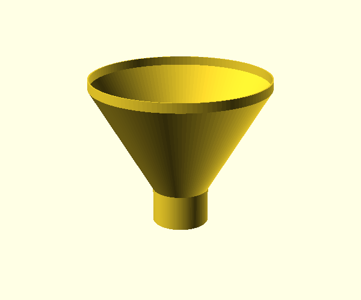
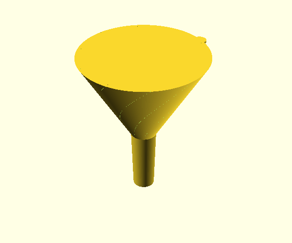

# parametric-funnel

Two parametric funnels for 3D printing, made in OpenSCAD.

| `funnel.scad` | `funnel_with_fins.scad` |
| --- | --- |
|  |  |

## `funnel.scad`

A hollow funnel: a straight throat, a cone and a rim, made by spinning one
profile. Set the variables at the top of the file, or call the module:

```openscad
use <funnel.scad>

funnel(funnel_height = 60, funnel_top_radius = 50, throat_height = 20,
       throat_radius = 15, wall_thickness = 0.8, top_edge_height = 5);
```

| Argument              | Meaning |
| --------------------- | ------- |
| `funnel_height`       | Height of the cone, in mm. |
| `funnel_top_radius`   | Inside radius at the top of the cone, in mm. |
| `throat_height`       | Height of the straight throat below the cone, in mm. |
| `throat_radius`       | Inside radius of the throat, in mm. |
| `wall_thickness`      | Wall thickness, square to the wall, in mm. |
| `top_edge_height`     | Height of the straight rim above the cone, in mm. |
| `smoothness_segments` | Segments around the circumference. Default 128. |

`funnel_profile()` returns the cross-section as points, for checking or reuse.

## `funnel_with_fins.scad`

A solid funnel to print in vase mode, with an air gap channel that lets air out
of the container, and optional twisted "turbo" fins. The fins are 0.1 mm
slits cut into the cone, meant to print as ribs in vase mode. The file's header
gives the print settings: vase mode, with a 0.7 mm extrusion width.

Adapted from
[vase mode parametric funnel v2](https://www.printables.com/model/895032-parametric-vase-mode-funnel-v2)
by DrJones, licensed CC-BY. Set the parameters at the top of the file:

| Parameter            | Meaning |
| -------------------- | ------- |
| `outer_diameter`     | Diameter of the wide end, in mm. |
| `cone_angle`         | Included angle of the cone, in degrees. |
| `stem_diameter`      | Diameter of the stem where it meets the cone, in mm. |
| `stem_length`        | Length of the stem, in mm. |
| `stem_taper`         | How much narrower the stem's end is, as a % of its diameter. |
| `air_gap_percentage` | Diameter of the air gap channel, as a % of the stem diameter. 0 for none. |
| `fin_type`           | 0 for no fins, 1 for the original fins, 2 for improved fins. |
| `fin_count`          | Number of fins. |
| `fin_twist_angle`    | How far the fins twist, in degrees. |
| `fin_direction`      | 0 for clockwise, 1 for counterclockwise. |
| `fin_depth`          | How deep the fins reach into the cone, in mm. |

## Development

With [just](https://just.systems/), OpenSCAD and Python 3, `just test` checks
the plain funnel's profile, then renders the plain funnel and the finned
funnel with each fin type and checks that each is one solid of the expected
size. `just images` renders the pictures in `assets/`.

## Acknowledgement

Also used as a reference:
[Parametric funnel](https://www.printables.com/model/1018668-parametric-funnel)
by Jaakko Kentta.

## License

MIT. See [LICENSE](./LICENSE). `funnel_with_fins.scad` is adapted from
DrJones's CC-BY design, credited above.
